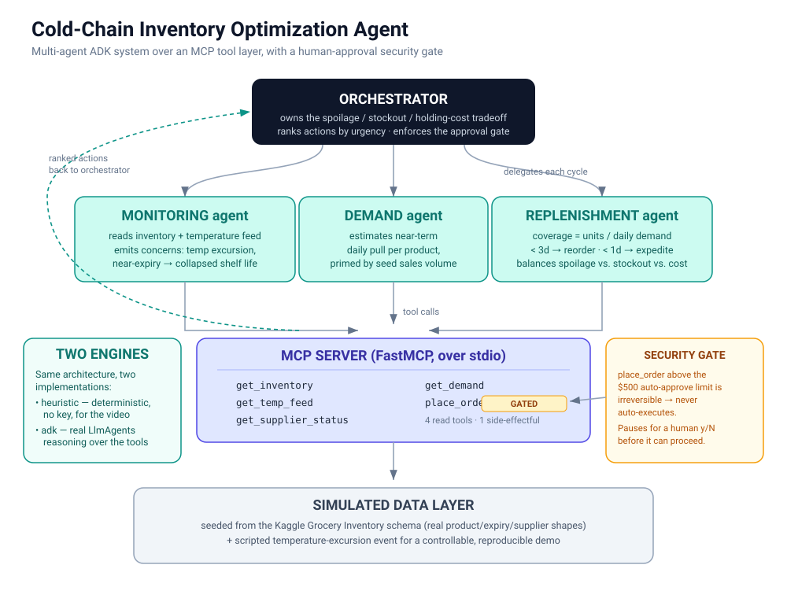

# Cold-Chain Inventory Optimization Agent

A multi-agent system that continuously monitors perishable inventory, reasons over
conflicting business goals — spoilage vs. stockout vs. holding cost — and produces a
ranked list of reorder actions. It executes the safe, cheap actions autonomously and
**pauses for human approval before anything irreversible or expensive.**

> Kaggle **"Agents for Business"** capstone. Built on a multi-agent ADK architecture
> with an MCP server as the data/tool layer and a cost-threshold security gate.

---

## The Problem

Cold-chain operators — grocery distributors, pharmacy depots, food producers — lose money
three ways at once, and the three losses pull against each other:

- **Spoilage.** Perishable stock expires. Over-ordering or holding too long destroys margin.
- **Stockouts.** Empty shelves lose sales and erode trust. Under-ordering is just as costly.
- **Operational waste.** Over-cooling, panic expedites, and emergency reorders burn cash that
  careful timing would have saved.

These are not three separate problems with three separate fixes. They are one continuous
balancing act over messy, fast-moving data: inventory counts, expiry windows, refrigeration
temperature feeds, shifting near-term demand, and unreliable supplier timelines — each arriving
from a different system, in a different shape, at a different cadence. Today this runs on
spreadsheets and operator intuition. Decisions lag the data, and the lag costs money.

## Why an Agent

A demand forecaster solves one slice. A reorder-point formula solves another. Neither *decides*.
The actual job is continuous synthesis of conflicting signals followed by judgment: what to do,
how urgently, and — critically — **when to act autonomously versus escalate to a human.**

That decision loop is exactly what an agent is for. It synthesizes heterogeneous, messy inputs
no single solver consumes; it reasons under conflicting objectives; it chooses actions and
sequences them by urgency and value; and it knows its own limits, pausing for human approval
before anything irreversible. The multi-agent decomposition here is genuine, not decorative:
monitoring, demand, and replenishment are distinct reasoning jobs with distinct inputs,
coordinated by an orchestrator that owns the tradeoff and the safety gate.

## Solution Overview

The agent turns a reactive, spreadsheet-driven process into a proactive one. Each cycle, the
orchestrator gathers fresh readings through the MCP tool layer, hands them to the three
specialist agents, and folds their outputs into a single ranked action list. Cheap, reversible
actions execute automatically; expensive irreversible ones stop at a human-approval gate.

The project ships two runnable cycles that together tell the whole story:

```bash
python -m demo.run --cycle normal      # calm steady-state: small reorders, nothing alarming
python -m demo.run --cycle excursion   # a fridge drifts out of range -> live re-rank -> approval gate
```

**Two engines, one architecture.** The same orchestrator/specialist/MCP design runs in either of
two modes. The default **heuristic engine** is deterministic Python — no API key, warm and
reproducible, which is what the recorded demo uses (the narrative calls for full control and zero
integration risk). The opt-in **ADK engine** (`--engine adk`) runs the specialists and orchestrator
as real ADK `LlmAgent`s that reason over the MCP tools through an `MCPToolset`. Both enforce the
same human-approval gate. This keeps the video bulletproof while making the multi-agent-ADK and
MCP-server concepts real end-to-end.

## Architecture



The orchestrator delegates each cycle to the three specialists, which read and act through the MCP
server over the simulated data layer; proposed orders pass back through the orchestrator's ranking
and the security gate before anything executes.

**Orchestrator** (`agents/orchestrator.py`) — the coordinator. It runs one full decision cycle:
collects specialist outputs, ranks the proposed actions by urgency (high → medium → low), and
enforces the human-approval gate on any action flagged `requires_approval`. Nothing irreversible
executes without passing through it.

**Monitoring agent** (`agents/specialists.py`) — reads inventory and the refrigeration temperature
feed and emits structured *concerns*. A cold batch that breaches its safe range has its effective
shelf life collapse to zero; a batch within four days of expiry is flagged as near-expiry.

**Demand agent** (`agents/specialists.py`) — estimates near-term daily pull per product, primed by
the seed dataset's sales volumes. This is the signal replenishment weighs stock coverage against.

**Replenishment agent** (`agents/specialists.py`) — the brain. It balances spoilage, stockout, and
holding cost into proposed orders using a deliberately legible coverage heuristic:
`coverage_days = available_units / daily_demand`, where excursion-hit batches contribute zero
units. Coverage under three days triggers a reorder; under one day, the gap is urgent and it
proposes an expedite — which may exceed the cost threshold and trip the security gate.

**MCP server** (`mcp_server/server.py`) — the tool layer every agent calls. Four read tools expose
inventory, the temperature feed, supplier status, and demand. The one side-effectful tool,
`place_order`, is the trust boundary: when an expedite's cost exceeds the auto-approve limit it
returns `requires_approval=True` and `irreversible=True`, and the orchestrator must not execute it
without a human yes.

**Simulated data layer** (`data/sim.py`) — seeded from the Kaggle Grocery Inventory schema, so
product names, expiry windows, reorder quantities, and supplier info look real. The temperature
feed and the on-cue excursion event are simulated for full control of the demo with zero
integration risk. Drop the full Kaggle CSV in `data/seed/` and it loads automatically.

**Data flow per cycle:** orchestrator → monitoring/demand/replenishment specialists → MCP read
tools → simulated feed, then proposed orders → MCP `place_order` → orchestrator ranking and the
approval gate → final ranked action list.

## Course Concepts Demonstrated

| Concept | Where it lives |
|---|---|
| **Multi-agent system (ADK)** | An orchestrator agent coordinating three specialist agents — monitoring, demand, and replenishment — each a distinct reasoning job with distinct inputs. Implemented as ADK `LlmAgent`s in `agents/adk_agents.py` (`--engine adk`), with a deterministic Python mirror in `agents/specialists.py` + `agents/orchestrator.py` for the recorded demo. |
| **MCP server** | A dedicated tool layer the agents call for all data and the one side-effectful action; read tools are unrestricted, `place_order` is gated. Served over stdio via FastMCP (`python -m mcp_server.server`) and consumed by the ADK agents through an `MCPToolset` (`mcp_server/server.py`). |
| **Security features** | A cost-threshold human-approval gate. Orders above `AUTO_APPROVE_LIMIT_USD` ($500) are marked irreversible and never auto-execute. Enforced deterministically in both engines — by the orchestrator loop in heuristic mode and by an ADK `before_tool_callback` that intercepts `place_order` in ADK mode (`mcp_server/server.py`, `agents/orchestrator.py`, `agents/adk_agents.py`). |
| **Deployability** | Each cycle is a single stateless run against the live feed — exactly one scheduled tick. Wire `python -m demo.run` to a scheduler (cron, a cloud job) and the agent runs autonomously, surfacing ranked actions and escalating only when the gate trips. |

## Setup

Requires **Python 3.10+**.

The **default demo runs on the standard library alone** — no install needed:

```bash
git clone https://github.com/liridonezhk/coldchain-agent.git
cd coldchain-agent
python -m demo.run --cycle normal
```

Install the dependencies only for the real agent layer (`--engine adk`) or to serve the MCP server
standalone:

```bash
python -m venv .venv
source .venv/bin/activate            # Windows: .venv\Scripts\activate
pip install -r requirements.txt      # mcp + google-adk + python-dotenv

cp .env.example .env                 # then put your key in .env (GOOGLE_API_KEY=...)
```

The project loads **only its own `.env`** (by explicit path), so it won't inherit a `.env` from a
parent folder or another project, and a project `.env` overrides any stale shell variable. `.env`
is gitignored. You can still `export GOOGLE_API_KEY=...` instead of using a file if you prefer.

To use Claude instead of Gemini for the ADK agents, swap the `MODEL` constant in
`agents/adk_agents.py` for the commented `LiteLlm(...)` line and set `ANTHROPIC_API_KEY` in `.env`.

### Data: sample vs. full dataset

The repo ships a small 6-row sample (`data/seed/grocery_inventory_sample.csv`) that the demo uses by
default — deterministic and clean, ideal for the recorded video. To run on the **real 990-row Kaggle
export**, drop it in as `data/seed/grocery_inventory_full.csv` and it's picked up automatically (the
full file wins over the sample). If neither is present, a baked-in fallback keeps the demo running.

The loader handles the real export's quirks so it's a true drop-in: it parses `$`-formatted prices,
filters to `Active` stock (≈332 of 990), infers refrigeration from the product **category** (the real
data stores street addresses, not cold zones), and anchors the simulation's "today" to the dataset's
2024 calendar so expiries land in a realistic spread instead of all reading as expired. On the full
data the excursion targets **Parmesan Cheese** (a dairy product spanning several cold batches); a
refrigeration failure collapses its cold stock and the ~$933 expedited replacement trips the approval
gate. The small sample keeps its fixed reference date, so its numbers never move.

## Running the Demo

### Beat 1 — Normal cycle

```bash
python -m demo.run --cycle normal
```

A routine cycle. The monitoring agent reads inventory, expiry windows, and the temperature feed;
the demand agent estimates near-term pull; the replenishment agent weighs the tradeoffs; the
orchestrator ranks. The result is calm — a small auto-executed reorder, nothing alarming:

```
  RANKED ACTIONS
  ------------------------------------------------------------
  [medium] Strawberries 250g AUTO_EXECUTED      $0     — coverage 2.0d (units 12 / demand 6/d)
```

### Beats 2 & 3 — Excursion and the approval gate

```bash
python -m demo.run --cycle excursion
```

A refrigeration unit drifts out of range on Batch B-001 (Whole Milk). The monitoring agent catches
the breach; risk reasoning concludes the batch's shelf life just collapsed; replenishment recomputes
and finds projected demand now exposed, so a replacement expedite becomes urgent. Because that
expedite costs $592 — above the $500 auto-approve limit — the orchestrator **stops and asks**:

```
>>> EVENT: temperature excursion on B-001 (Whole Milk 2L)

  ⛔ APPROVAL REQUIRED (irreversible, over auto-approve limit)
     Expedite 40 units of Whole Milk 2L — $592
     Approve? [y/N]
```

The gate is interactive: type `y` to approve (the action becomes `APPROVED_EXECUTED`) or anything
else to leave it `PENDING_APPROVAL`. The cheaper produce reorder auto-executes either way:

```
  RANKED ACTIONS
  ------------------------------------------------------------
  [  high] Whole Milk 2L PENDING_APPROVAL   $592   — coverage 0.0d (units 0 / demand 8/d)
  [medium] Strawberries 250g AUTO_EXECUTED      $0     — coverage 1.7d (units 12 / demand 7/d)
```

Autonomy where it's safe, a gate where it isn't. (Demand figures carry light randomness, so exact
numbers vary slightly between runs; the urgency ordering and the gate do not.)

### The ADK engine (real LLM agents)

The same two cycles run through genuine ADK agents with `--engine adk`:

```bash
pip install -r requirements.txt
export GOOGLE_API_KEY=...                       # Gemini key (or swap MODEL for Claude)
python -m demo.run --cycle excursion --engine adk
```

Here the orchestrator delegates to the monitoring, demand, and replenishment `LlmAgent`s, which
call the MCP tools over stdio. The approval gate is enforced by an ADK `before_tool_callback` that
intercepts `place_order` — so the same `$592 > $500` expedite still pauses for your `y/N` before it
can execute. Output is the agents' own narrated ranked list rather than the fixed table above, so
use the default heuristic engine for the recorded video and the ADK engine to demonstrate the live
multi-agent reasoning.

### Holiday-aware demand

Perishable demand spikes before big holidays, and unevenly by category — dairy, produce, meat, and
bakery move most. The demand agent lifts its estimate for the affected categories during the lead-up
to a holiday (New Year, Valentine's, Independence Day, Halloween, Thanksgiving, Christmas). Use
`--as-of` to set the simulation date and watch it change the agent's behaviour:

```bash
python -m demo.run --cycle normal --as-of 2026-06-28   # Independence Day lead-up
```

```
  🎉 Holiday demand uplift active: Independence Day — elevated pull on perishable categories …
  [  high] Strawberries 250g      PENDING_APPROVAL   $512   — coverage 0.0d (units 0 / demand 11/d)
  [  high] Spinach Bag 200g       AUTO_EXECUTED      $281   — coverage 0.0d (units 0 / demand 9/d)
```

The uplift is **dormant on ordinary days**, so the default sample and full-dataset runs (and the
recorded demo) are unchanged. It's a static, deterministic calendar today; the demand agent's
`get_demand` is also the natural place to wire a live external signal (a holidays API or web search)
if you want the agent to discover demand drivers instead of reading them from a table.

## Retrieval over food-safety guidance (RAG)

The agents can also reason over real documents rather than only over numbers. `search_guidance` is
an MCP tool like the others. It retrieves passages from a small corpus of public food-safety and
cold-chain rules, and every rule-dependent recommendation has to cite the passage it came from.
When the excursion fires, the agent looks up the rule for that product class, temperature and
duration, and attaches the quoted rule and its citation to the action. If the corpus doesn't cover
the case, the order goes to a human.

Everything is plain Python you can read top to bottom. BM25 is about 50 lines, the vector store is
one NumPy matrix, the embedding model runs directly in `onnxruntime`, and there's no framework and
no hosted service.

```bash
pip install -r requirements-rag.txt          # numpy, onnxruntime, tokenizers, pypdf
python -m rag.fetch_corpus                   # download sources (hashes -> fetch_log.json)
python -m rag.fetch_model                    # MiniLM ONNX weights from Hugging Face
python -m rag.fetch_model --repo BAAI/bge-small-en-v1.5
python -m rag.extract_corpus                 # raw -> rag/corpus/text/*.txt + manifest.json
python -m rag.eval.harness --retriever shipped   # or bm25 / minilm / bge / hybrid, --chunking ...
python -m rag.eval.compare                   # the comparison table below
python -m rag.eval.scenarios                 # excursion check: right rule vs lookalike
python -m demo.run --cycle excursion         # the demo, now with the cited rule
```

The extracted text is committed, so the evaluation runs without re-downloading anything. Only the
model weights (about 90 MB and 130 MB) have to be fetched.

### 1. Corpus and provenance

| id | document | publisher | what it's here for |
|---|---|---|---|
| `fda-food-code-2022` | FDA Food Code 2022, §3-202.11–3-203 and Subpart 3-501 (pp. 69–72, 90–100) | US FDA | 41 °F cold holding, cooling, date marking, the 4/6-hour time-as-a-control rule |
| `fda-pmo-2023` | Pasteurized Milk Ordinance 2023, Section 7 Table 1 and Item 17p (pp. 56–58, 136–138) | US FDA | 45 °F milk limits: a deliberate near-miss against the Food Code's 41 °F |
| `ecfr-21-1-subpart-o` | 21 CFR 1 Subpart O, Sanitary Transportation of Human and Animal Food | eCFR | carrier, loader and receiver duties when temperature control fails |
| `fsa-chilling` | Food hygiene for your business: chilling and freezing | UK FSA (GOV.UK) | 8 °C legal limit, the UK 4-hour rule |
| `eu-853-2004` | Reg. (EC) 853/2004, consolidated 2026-05-07 | EU (Cellar) | limits by product class: meat 7 °C, offal 3 °C, poultry 4 °C, raw milk 8/6 °C, fish at melting ice |
| `eu-37-2005` | Reg. (EC) 37/2005, temperature monitoring of quick-frozen food | EU (Cellar) | record keeping |
| `eu-dir-89-108` | Dir. 89/108/EEC, quick-frozen foodstuffs (consolidated 2013) | EU (Cellar) | −18 °C and the +3 °C transport tolerance |

Every document is public domain, under the Open Government Licence, or under EU reuse terms.
`rag/corpus/manifest.json` records, for each one: the source URL, the URL actually served, the
UTC retrieval time, the SHA-256 and size of the raw bytes, the PDF pages kept, and the licence.
`extract_corpus.py` refuses to run if a raw file doesn't match its logged hash. For the two long
PDFs only the temperature-control sections are kept, so 700 pages of unrelated text doesn't
drown everything else; the page ranges sit in `PDF_PAGES` and in the manifest.

Six USDA FSIS consumer pages are listed in `sources.json` but not fetched, because fsis.usda.gov
blocks scripted downloads (HTTP 403) and the fetcher doesn't try to get around that. EUR-Lex's
web pages return a bot challenge, so the EU texts come from the EU Publications Office's Cellar
service, which is the documented machine-access route to the same documents.

### 2. Chunking strategy

`rag/chunking.py` splits on headings first, then packs sentences.

1. **Split at every heading.** The extractor turns HTML `h1–h4`, EUR-Lex's CSS title classes and
   the Food Code's numbered paragraphs (`3-501.16 …`) into markdown-style headings. A rule and the
   product it applies to almost always sit under the same heading.
2. **Pack sentences** greedily into chunks of at most 200 words, with a one-sentence overlap when
   a section has to be split.
3. **Prefix every chunk with its heading path**, for example
   `ANNEX III > SECTION II: MEAT FROM POULTRY AND LAGOMORPHS > CHAPTER V`. In regulations the
   product class is often named only in a heading two levels up. The poultry rule's own sentence,
   "Meat must attain a temperature of not more than 4 °C before transport", never says "poultry".

That gives 403 chunks with a median of 180 words. Two alternatives were measured against it: fixed
200-word windows every 150 words, which ignore structure, and section chunks with the document
title also prepended.

### 3. Evaluation method

`rag/eval/questions.jsonl` holds 29 hand-labelled questions, written and committed before any
retriever existed (see the git history):

* **18 answerable**, a mix of keyword-style and paraphrased questions.
* **5 near-miss**, each with a labelled *lookalike*: a passage that looks right but is the wrong
  rule. Examples are the US milk-plant 45 °F rule against the retail 41 °F rule, the UK 4-hour rule
  against the US 4-hour rule, and poultry 4 °C against red meat 7 °C.
* **6 unanswerable**: questions the corpus really doesn't cover, such as vaccines, Japan, chocolate
  and refrigerants.

Gold passages are **exact quotes**, not chunk ids. The harness finds each quote in the document
text and counts a retrieved chunk as relevant when its character span overlaps a gold span. That's
why the same labels can score any chunking strategy.

The metrics are averaged over the 23 answerable and near-miss questions:

* **recall@k**: the share of a question's gold passages found in the top k.
* **precision@k**: the share of the top k that's relevant. With one gold passage per question,
  precision@5 can't exceed 0.2–0.4, so compare it across retrievers rather than reading it as an
  absolute.
* **MRR**: 1 divided by the rank of the first relevant chunk.
* **lookalike@1**: how often the top chunk is the lookalike and not the gold passage.

The no-answer behaviour is measured separately. A retriever always returns *something*, so "the
corpus doesn't say" has to come from a threshold on a score. For every threshold the harness
reports the **false-answer** rate (unanswerable questions that clear it) and the **wrong-abstain**
rate (answerable questions that fall below it).

### 4. Lexical vs semantic: the measured comparison

| retriever-chunking | R@1 | R@3 | R@5 | MRR | near-miss R@1 | near-miss R@5 | lookalike@1 | false-answer | wrong-abstain |
|---|---|---|---|---|---|---|---|---|---|
| bm25-section | 0.50 | 0.72 | 0.76 | 0.66 | 0.30 | 0.50 | 0.00 | 0.00 | 0.48 |
| bm25-fixed | 0.33 | 0.76 | 0.83 | 0.54 | 0.20 | 0.40 | 0.00 | 0.33 | 0.00 |
| minilm-section | 0.56 | 0.65 | 0.76 | 0.66 | 0.20 | 0.50 | 0.00 | 0.00 | 0.04 |
| minilm-fixed | 0.56 | 0.85 | 0.96 | 0.73 | 0.40 | 0.80 | 0.00 | 0.00 | 0.04 |
| **bge-section** | **0.65** | 0.87 | **1.00** | **0.78** | **0.80** | **1.00** | 0.00 | 0.00 | 0.30 |
| bge-fixed | 0.52 | 0.76 | 0.87 | 0.68 | 0.20 | 0.60 | 0.00 | 0.00 | 0.30 |
| bge-section-title | 0.52 | 0.91 | 1.00 | 0.70 | 0.40 | 1.00 | 0.00 | 0.00 | 0.39 |
| hybrid-section (BM25 + MiniLM, RRF) | 0.61 | 0.94 | 0.96 | 0.77 | 0.40 | 0.80 | 0.20 | 0.00 | 0.39 |
| **shipped** (BGE ranks, MiniLM gates) | **0.65** | 0.87 | **1.00** | **0.78** | **0.80** | **1.00** | 0.00 | **0.00** | **0.04** |

Results are in `rag/eval/results/*.json`, with every question's top chunks. The two abstention
columns use the best threshold for each retriever, picked on these same questions, so read them as
optimistic.

What the numbers say:

* **BM25 is a respectable baseline but fails on paraphrase.** It misses "fresh fish" because the
  rule says "fishery products … melting ice". It misses "receiver check for temperature abuse"
  because a fridge-related FSA chunk shares more words with the question. It's at its best on
  questions that repeat the document's own vocabulary and numbers.
* **Embeddings fix paraphrase, and the stronger model fixes near-misses.** BGE-small with section
  chunks finds the gold passage in the top 5 for all 23 questions, and ranks it first in 4 of the 5
  near-miss questions, against 2 of 5 for BM25.
* **Chunking interacts with the model.** Section chunks help BGE (MRR 0.78 against 0.68 for fixed
  windows) but hurt MiniLM (0.66 against 0.73). MiniLM truncates at 256 tokens and was trained on
  short texts, so the long heading path costs it more than it adds. Prepending document titles
  made BGE worse (MRR 0.70), so it isn't shipped.
* **The hybrid wasn't better than BGE alone**, and it was the only configuration to rank a
  lookalike first. Fusing in BM25 brings back its preference for passages with matching numbers.
* **BGE's scores don't separate answerable from unanswerable questions.** Its top scores fall in a
  narrow band (unanswerable 0.61–0.75, answerable 0.66–0.83), so any threshold either answers
  unanswerable questions or refuses a third of the answerable ones. MiniLM's scores separate
  cleanly: unanswerable ≤ 0.593, and all but one answerable ≥ 0.613.

**What ships, and why:** BGE-small over section chunks ranks the passages, because it has the best
recall, MRR and near-miss accuracy. The MiniLM top score over the same chunks decides `supported`,
with a threshold of 0.60, because it's the only score that separates "covered" from "not covered".
The cost is a second embedding of each query, about 5 ms on a laptop CPU. On these questions that gives 0 of 6
false answers and 1 of 23 wrong abstentions. The one wrong abstention is q08, the informally worded
"reefer unit failed" question.

**How far to trust this:** 29 questions is small. One question moves recall by 0.04, and the
abstention threshold was picked on the same set it's scored on. The ranking differences between
BM25 and BGE are large enough to be real. The 0.60 threshold needs more unanswerable questions
before it can be trusted outside this set.

### 5. The MCP tool

`search_guidance(query, k=5)` is registered in `mcp_server/server.py` next to the other tools and
served over stdio by FastMCP. It returns:

```json
{"supported": true, "support_score": 0.674, "support_threshold": 0.6,
 "passages": [{"chunk_id": "fda-pmo-2023#18", "title": "Grade \"A\" Pasteurized Milk Ordinance…",
               "section": "ITEM 17p. COOLING OF MILK AND/OR MILK PRODUCTS",
               "source_url": "https://www.fda.gov/media/180975/download", "score": 0.79,
               "text": "…On delivery vehicles, the temperature of milk and milk products shall not exceed 7°C (45°F)…"}]}
```

The retriever loads lazily, so the stdlib-only demo is unaffected unless it retrieves.

### 6. Grounded generation with citations (`rag/grounding.py`)

* **Heuristic engine:** `extractive_answer` quotes the one or two retrieved sentences that best
  match the question, verbatim, each followed by `[chunk_id]`. It's deterministic and generates no
  free text, so it can't state a limit that isn't in the corpus.
* **ADK engine:** a `compliance_agent` is instructed to quote the rule and cite its chunk_id, and to
  answer only from retrieved passages. After the cycle, `check_citations` checks the
  orchestrator's final text deterministically: every cited chunk must have been returned by
  `search_guidance` during the cycle, and every quoted span must appear in it. Any failure is
  printed as a warning not to act on the rule. The ADK path builds and wires up correctly, but it
  wasn't run end to end here because that needs a model API key.
* **When `supported` is false**, both engines return a fixed sentence saying the corpus doesn't
  cover the case. The orchestrator then marks the order `requires_approval`, whatever it costs.

### 7. The temperature-excursion scenario

The excursion now carries a duration as well as a temperature (`inject_temp_excursion(temp_c=11.5,
hours=5)`). The compliance step builds one query from product, category, temperature, hours and
setting, retrieves, and attaches the cited rule to the action:

```
  [  high] Whole Milk 2L          PENDING_APPROVAL   $592   — coverage 0.0d (units 0 / demand 8/d)
           rule: “All raw milk and milk products shall be maintained at 7°C (45°F) or less …” [fda-pmo-2023#10] …
           cite: [fda-pmo-2023#10] Grade "A" Pasteurized Milk Ordinance, 2023 Revision — ITEM 17p. COOLING OF MILK …
```

`rag/eval/scenarios.jsonl` labels 7 excursions, each with the correct passage and its most
tempting lookalike. `python -m rag.eval.scenarios` runs the agent's own path and classifies both
the top passage and the rule it quotes first:

| event | correct rule | top passage | quoted rule |
|---|---|---|---|
| s1 whole milk, 11.5 °C, 5 h, US storage (**the demo's event**) | Food Code 3-501.19, 4-hour limit | LOOKALIKE (PMO milk storage) | OTHER (PMO condensed milk) |
| s2 milk, 9 °C, US delivery vehicle | PMO, vehicles ≤ 7 °C | CORRECT | CORRECT |
| s3 yogurt, 14 °C, 6 h, failed reefer, US | 21 CFR 1.908(a)(6), do not sell | OTHER | OTHER |
| s4 frozen chicken, −14 °C, EU transport | Dir. 89/108, −18 °C + 3 °C | OTHER (fresh-meat rule) | OTHER |
| s5 fresh poultry, 6 °C, EU storage | Reg. 853 poultry 4 °C | CORRECT | CORRECT |
| s6 raw milk, 9 °C, EU farm | Reg. 853 raw milk 8 °C | CORRECT | OTHER (US PMO rule) |
| s7 whole strawberries, 12 °C | not covered | ABSTAINED ✓ | ABSTAINED ✓ |

The top passage was correct in **4 of 7** cases, and the rule quoted first was correct in **3 of 7**.
The failures share one cause. The query names the product ("Whole Milk", "Greek Yogurt", "Frozen
Chicken"), and similarity follows the product name to product-specific passages, while the rule
that actually applies is generic: "TCS food", "food requiring temperature control", "quick-frozen
foodstuffs". The retrieval evaluation didn't show this, because its questions name the product
class the way the rules do. The likely fix is to map each product to its regulatory class before
querying, for example "Whole Milk 2L" to "pasteurized milk, a TCS food", and to run one query per
applicable regime. That would be measured with this same scenario harness, rather than by adjusting
the query until these 7 pass.

### Layout

```
rag/
├── corpus/  sources.json · fetch_log.json · manifest.json · text/*.txt   (raw/ is gitignored)
├── fetch_corpus.py · fetch_model.py · extract_corpus.py
├── chunking.py · bm25.py · embeddings.py · retrievers.py
├── tool.py         # search_guidance, served by mcp_server/server.py
├── grounding.py    # extractive cited answers + citation checker
├── excursion.py    # event -> query -> cited rule
└── eval/  questions.jsonl · scenarios.jsonl · harness.py · scenarios.py · compare.py · results/
```

## Project Layout

```
coldchain/
├── README.md                 # this file
├── LICENSE                   # MIT (code); dataset stays CC BY 4.0
├── .env.example              # copy to .env for the ADK engine's API key
├── requirements.txt          # mcp + google-adk (only needed for the agent layer)
├── requirements-rag.txt      # numpy + onnxruntime + tokenizers + pypdf (retrieval layer)
├── docs/
│   ├── WRITEUP.md            # project writeup (Agents for Business)
│   └── architecture.svg      # architecture diagram (also embedded above)
├── data/
│   ├── sim.py                # simulated data layer (Kaggle-schema seed + excursion injector)
│   └── seed/
│       ├── grocery_inventory_sample.csv   # 6-row sample — the demo's default dataset
│       └── grocery_inventory_full.csv     # (not included) add the real 990-row Kaggle export here
├── mcp_server/
│   └── server.py             # MCP tool layer (FastMCP), incl. the gated place_order and search_guidance
├── agents/
│   ├── specialists.py        # heuristic monitoring / demand / replenishment (default engine)
│   ├── orchestrator.py       # heuristic ranking + human-approval gate (default engine)
│   └── adk_agents.py         # ADK LlmAgents over MCP + approval callback (--engine adk)
└── demo/
    ├── run.py                # demo runner (both cycles, both engines, --as-of)
    └── record.py             # one-command runner for recording the video
```

## Data Attribution

Seeded from the **Grocery Inventory and Sales Dataset** by Salahuddin Ahmed Shuvo, licensed
**CC BY 4.0**.
<https://www.kaggle.com/datasets/salahuddinahmedshuvo/grocery-inventory-and-sales-dataset>

Product names, expiry windows, reorder quantities, and supplier details derive from this dataset's
schema. The refrigeration temperature feed and the temperature-excursion event are simulated to give
the demo a controllable, reproducible reaction the agent responds to live.

## License

Project code is released under the **MIT License** (see [LICENSE](LICENSE)). The seed dataset
retains its original **CC BY 4.0** license as noted above.
